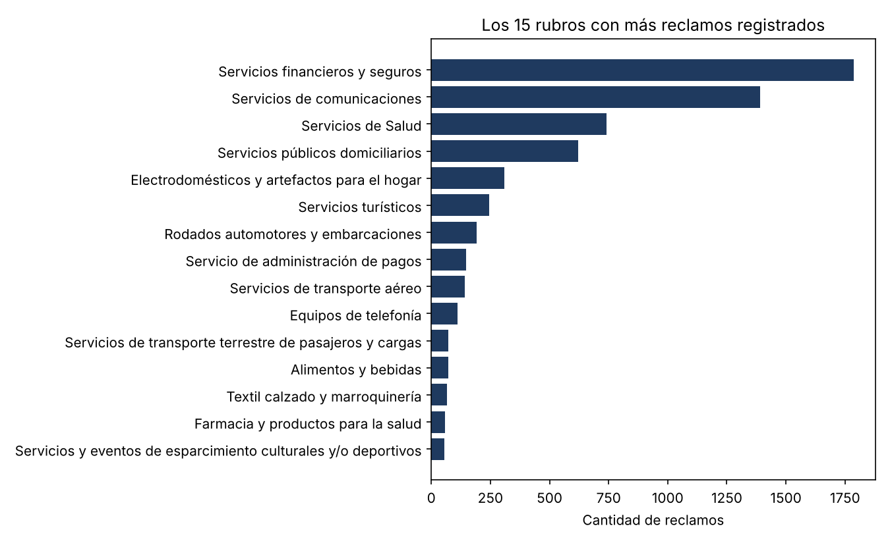
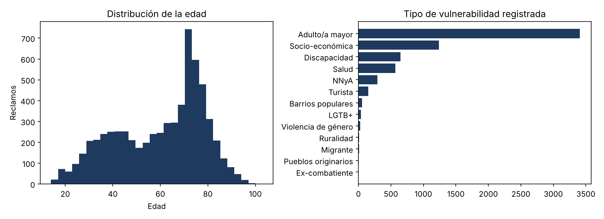
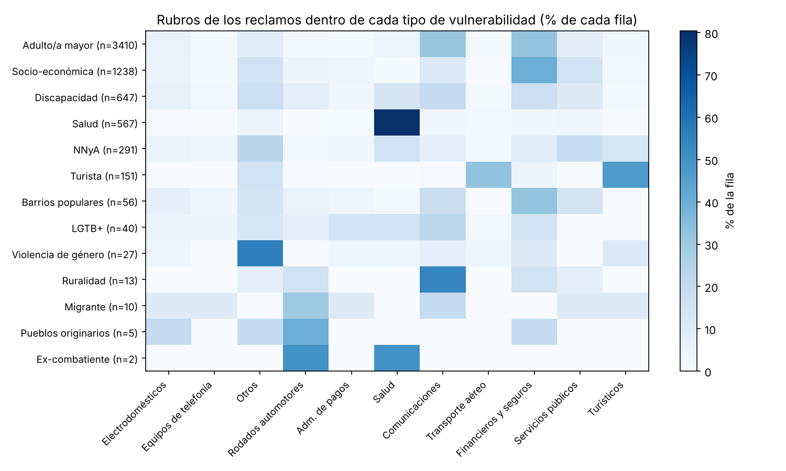
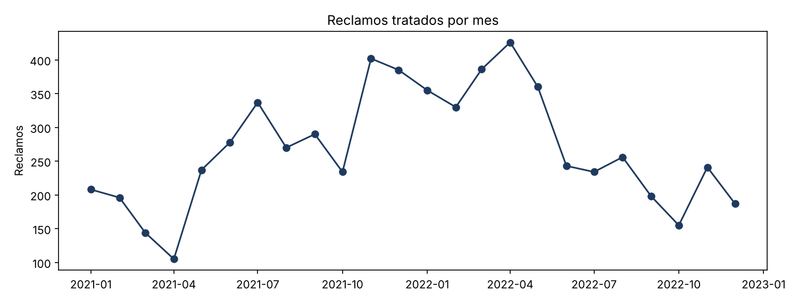
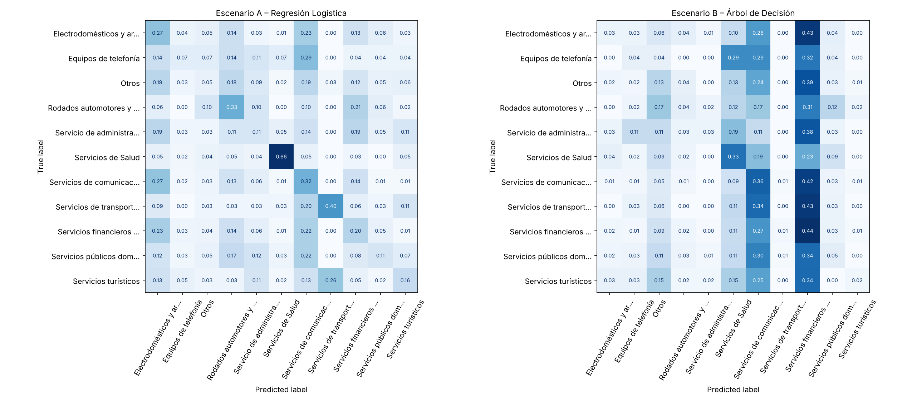

# Modelado y resultados

Presentación del modelo, de la evaluación y de las conclusiones. Todas las cifras salen de los notebooks
[`1.0-dm-eda-y-preprocesamiento.ipynb`](../notebooks/1.0-dm-eda-y-preprocesamiento.ipynb) y
[`2.0-dm-modelado-y-evaluacion.ipynb`](../notebooks/2.0-dm-modelado-y-evaluacion.ipynb) (semilla 42). Las
explicaciones de *por qué* ocurre algo se presentan como **hipótesis**: con estos datos no se pueden comprobar.

## 1. Resumen

- **Problema:** clasificar el rubro de un reclamo de consumidores (11 clases) a partir de edad, género, provincia y,
  según el escenario, el tipo de vulnerabilidad. Es una clasificación **multiclase**.
- **Dos escenarios**, porque no está confirmado que la vulnerabilidad esté disponible al ingresar el reclamo:
  **A** (con vulnerabilidad, condicionado a ese supuesto) y **B** (sin vulnerabilidad).
- **Modelos probados:** Regresión Logística, Árbol de Decisión y K-NN. El modelo final de cada escenario se eligió por
  validación cruzada, antes de mirar la prueba: **Regresión Logística** en A y **Árbol de Decisión** en B.
- **Resultado principal:** los modelos superan claramente a la solución sencilla (predecir siempre el rubro más
  frecuente), pero con una capacidad limitada. F1 macro en la prueba: **0,224** (A) y **0,126** (B), frente a **0,039**
  de la referencia.
- **La vulnerabilidad aporta mucho** (A − B = +0,097 en F1 macro), pero eso **no valida su uso**: puede no estar
  disponible en el momento de la predicción.

## 2. Datos (recordatorio)

- **Fuente:** Datos Argentina, Ministerio de Desarrollo Productivo, *Programa Consumidores Hipervulnerables* (licencia
  CC BY 4.0). Datos de las denuncias de consumidores en la Ventanilla Única Federal de Consumo; el organismo detecta
  qué consumidores son hipervulnerables (Resolución 139/2020). Origen completo en
  [`01_descripcion_dataset.md`](01_descripcion_dataset.md).
- **Qué es cada fila:** un reclamo registrado. 6.457 reclamos y 8 columnas, de enero de 2021 a diciembre de 2022, sin
  valores faltantes. No hay identificador de reclamo ni de persona.
- **Variable objetivo:** `rubro_agrupado`, con 11 valores: 10 rubros que representan al menos 1,5 % del entrenamiento
  y `Otros` (37 rubros chicos).

## 3. Análisis exploratorio

Los gráficos están en `reports/figures/`. La exploración descriptiva usa el conjunto completo; los análisis de
asociación usan solo el entrenamiento.

**Rubros (variable objetivo).** Están muy desbalanceados: el rubro más frecuente (Servicios financieros y seguros)
reúne 27,7 % de los reclamos y los cuatro principales suman 70,3 %. Hay 47 rubros y 27 de ellos tienen menos de
30 casos.



**Perfil de las personas.** Por vulnerabilidad registrada: «Adulto/a mayor» 52,8 %, «Socio-económica» 19,2 %,
«Discapacidad» 10,0 %, «Salud» 8,8 % y «NNyA» 4,5 %; las demás categorías tienen muy pocos casos. La edad tiene mediana
65 y media 60,0 (rango de 14 a 103). Ciudad de Buenos Aires y Buenos Aires concentran 75,6 % de los reclamos, por lo
que en la mayoría de las provincias hay pocos casos.



**Asociaciones dentro de los reclamos registrados (entrenamiento).** Entre los reclamos de «Salud» predomina el rubro
Servicios de Salud (80 %); entre los de «Adulto/a mayor», Servicios financieros y seguros (32 %); entre los
«Socio-económica», también financieros (41 %). El V de Cramér de cada variable con el rubro es: vulnerabilidad 0,283,
año 0,106, provincia 0,093, género 0,088 y mes 0,076.



**Tiempo.** Se registran entre 105 y 426 reclamos tratados por mes (3.086 en 2021 y 3.371 en 2022).



**Conclusiones del análisis exploratorio**
1. El problema es de clases muy desbalanceadas; la exactitud sola no sirve para evaluar.
2. La vulnerabilidad es la variable más asociada con el rubro, y las demás tienen asociaciones bajas con él.
3. Que ciertos rubros predominen en ciertos tipos de vulnerabilidad es una asociación entre reclamos **registrados**: no
   mide qué grupos están más expuestos, porque no hay datos de quienes no reclamaron.
4. **Hipótesis:** la fuerte asociación de «Salud» con Servicios de Salud podría deberse a que la vulnerabilidad se
   registra a partir de la situación que originó el reclamo. No se puede confirmar con estos datos.

## 4. Diseño de la evaluación

**Registros excluidos:** ninguno (se usan los 6.457 reclamos; las filas repetidas se mantienen). Las variables excluidas
se indican abajo. **Unidades:** `edad` en años (el dataset no aclara a quién corresponde).

| Aspecto | Decisión |
|---|---|
| Uso previsto (supuesto) | Clasificar un reclamo al ingresarlo, antes de conocer su rubro |
| Escenario A | Edad, género, provincia y vulnerabilidad (condicionado a que esté disponible al ingreso) |
| Escenario B | Edad, género y provincia |
| Variables excluidas | `motivo` (puede revelar el rubro), fecha de tratamiento (no necesariamente de ingreso), `provincia_id` (duplica la provincia) |
| Partición | Aleatoria estratificada: 4.842 reclamos de entrenamiento y 1.615 de prueba |
| Clases | Definidas con el entrenamiento (≥ 1,5 %) y fijas al evaluar; lo que no está en la lista pasa a `Otros` |
| Selección de hiperparámetros y del modelo | Validación cruzada de 5 particiones solo con el entrenamiento, con el preprocesamiento dentro de un `Pipeline`; criterio: F1 macro |
| Prueba | Se usa una vez por modelo, solo para informar |
| Modelo de referencia | Predecir siempre la clase mayoritaria del entrenamiento (Servicios financieros y seguros) |
| Métricas | Exactitud, exactitud balanceada, F1 macro, F1 ponderado y precisión/recall/F1 por clase; intervalos del 95 % por remuestreo de los casos de prueba |

La justificación de cada decisión está en [`02_decisiones_metodologicas.md`](02_decisiones_metodologicas.md).

## 5. Modelos e hiperparámetros

**Cómo produce cada modelo una predicción** (el *cómo*; el *cuándo* está en la sección 4):
- **Regresión Logística (multinomial):** a cada reclamo le asigna un puntaje por clase, combinando linealmente las
  columnas ya codificadas con un coeficiente por columna y clase más un intercepto. Los puntajes se convierten en
  probabilidades y se predice la clase de mayor probabilidad. `C` controla cuánto se penalizan los coeficientes grandes.
- **Árbol de Decisión:** divide los reclamos con preguntas sucesivas sobre las variables (por ejemplo, «¿la edad es
  mayor que 60?») hasta llegar a una hoja; la predicción es la clase más frecuente entre los reclamos de
  entrenamiento que cayeron en esa hoja. `max_depth` y `min_samples_leaf` limitan cuánto se subdivide.
- **K-NN:** busca los `n_neighbors` reclamos de entrenamiento más parecidos (distancia entre las columnas ya
  codificadas y escaladas) y predice la clase que más se repite entre ellos; con `weights="distance"`, los más
  cercanos pesan más.


| Modelo | Hiperparámetros que se prueban | Desbalance |
|---|---|---|
| Regresión Logística | `C` ∈ {0,01; 0,1; 1; 10}; `class_weight` ∈ {ninguno, `balanced`} | `class_weight` |
| Árbol de Decisión | `max_depth` ∈ {3, 5, 8, 12, 16, sin límite}; `min_samples_leaf` ∈ {1, 10, 30}; `class_weight` ∈ {ninguno, `balanced`} | `class_weight` |
| K-NN | `n_neighbors` ∈ {5, 15, 31, 61}; `weights` ∈ {`uniform`, `distance`} | Sin ponderación de clases (`weights` solo pondera el voto de los vecinos) |

Preprocesamiento (dentro del `Pipeline`): codificación one-hot de las variables categóricas y estandarización de `edad`.

**Resultado de la validación cruzada** (F1 macro medio ± desvío entre las 5 particiones):

| Escenario | Modelo | F1 macro (CV) | Mejores hiperparámetros |
|---|---|---|---|
| A | **Regresión Logística** | **0,213** ± 0,028 | `C=0,1`, `class_weight="balanced"` |
| A | Árbol de Decisión | 0,201 ± 0,011 | sin límite de profundidad, `min_samples_leaf=10` |
| A | K-NN | 0,199 ± 0,015 | `n_neighbors=15`, `weights="distance"` |
| B | Regresión Logística | 0,117 ± 0,009 | `C=0,1`, `class_weight="balanced"` |
| B | **Árbol de Decisión** | **0,131** ± 0,004 | sin límite de profundidad, `min_samples_leaf=1` |
| B | K-NN | 0,128 ± 0,007 | `n_neighbors=31`, `weights="distance"` |

Las diferencias entre modelos son pequeñas frente al desvío entre particiones, por lo que la elección del modelo final
(el de mayor F1 macro medio, regla fijada de antemano) es en buena medida una convención y **no demuestra** que ese
modelo sea mejor que los otros. En B, el árbol elegido es muy profundo (36 niveles y 970 hojas): casi memoriza las
combinaciones de perfil del entrenamiento.

## 6. Resultados en el conjunto de prueba

| Escenario | Modelo | Exactitud | Exactitud balanceada | F1 macro | IC 95 % del F1 macro |
|---|---|---|---|---|---|
| — | Referencia (clase mayoritaria) | 0,277 | 0,091 | 0,039 | (0,037; 0,042) |
| A | Regresión Logística | 0,259 | 0,245 | 0,224 | (0,200; 0,244) |
| A | Árbol de Decisión | 0,370 | 0,213 | 0,216 | (0,192; 0,240) |
| A | K-NN | 0,336 | 0,212 | 0,222 | (0,196; 0,245) |
| B | Regresión Logística | 0,176 | 0,156 | 0,123 | (0,107; 0,139) |
| B | Árbol de Decisión | 0,262 | 0,132 | 0,126 | (0,109; 0,144) |
| B | K-NN | 0,261 | 0,134 | 0,130 | (0,112; 0,148) |

- Todos los modelos superan a la referencia en F1 macro y exactitud balanceada (los intervalos de la diferencia no
  incluyen el 0).
- **La exactitud engaña:** la regresión logística del escenario A tiene exactitud 0,259, menor que la de la referencia
  (0,277), pero una exactitud balanceada de 0,245 frente a 0,091. Acierta menos en total, pero identifica mucho mejor
  las clases minoritarias.

**Modelo final por clase** (el intervalo de las clases chicas es amplio: solo 28 a 48 casos de prueba):

| Clase | Casos de prueba | A: precisión / recall / F1 | B: precisión / recall / F1 |
|---|---|---|---|
| Servicios financieros y seguros | 447 | 0,43 / 0,20 / 0,27 | 0,32 / 0,44 / 0,37 |
| Servicios de comunicaciones | 348 | 0,33 / 0,32 / 0,33 | 0,28 / 0,36 / 0,32 |
| Otros | 194 | 0,15 / 0,05 / 0,08 | 0,17 / 0,13 / 0,15 |
| Servicios de Salud | 185 | 0,83 / 0,67 / 0,74 | 0,27 / 0,33 / 0,30 |
| Servicios públicos domiciliarios | 155 | 0,25 / 0,11 / 0,15 | 0,11 / 0,05 / 0,06 |
| Electrodomésticos | 77 | 0,07 / 0,27 / 0,11 | 0,07 / 0,03 / 0,04 |
| Servicios turísticos | 61 | 0,16 / 0,16 / 0,16 | 0,10 / 0,02 / 0,03 |
| Rodados automotores | 48 | 0,07 / 0,33 / 0,12 | 0,06 / 0,04 / 0,05 |
| Administración de pagos | 37 | 0,04 / 0,11 / 0,05 | 0,13 / 0,03 / 0,04 |
| Transporte aéreo | 35 | 0,39 / 0,40 / 0,39 | 0,00 / 0,00 / 0,00 |
| Equipos de telefonía | 28 | 0,05 / 0,07 / 0,06 | 0,03 / 0,04 / 0,03 |

(A: Regresión Logística; B: Árbol de Decisión. Las matrices de confusión están en
`reports/figures/05_matrices_confusion.png`.)



**Escenario A frente a B** (mismos casos de prueba): el F1 macro es 0,097 mayor con vulnerabilidad (IC 95 %:
0,070 a 0,122) y la exactitud balanceada 0,113 mayor (0,082 a 0,145). La mejora del recall se concentra en transporte
aéreo (de 0,00 a 0,40), Servicios de Salud (de 0,33 a 0,67), rodados (de 0,04 a 0,33) y electrodomésticos (de 0,03 a
0,27), mientras que baja en Servicios financieros y seguros (de 0,44 a 0,20), porque B tiende a predecir más esa
clase.

## 7. Comprobaciones complementarias

**Evaluación temporal (entrenar con 2021 y evaluar con 2022).** Las clases, los hiperparámetros y el preprocesamiento
se definen solo con 2021. El F1 macro baja respecto de la partición aleatoria: de 0,224 a 0,187 en A y de 0,126 a 0,106 en
B (modelo elegido por validación cruzada dentro de 2021 en ambos casos: K-NN), frente a una referencia de 0,041.
Esto sugiere que el rendimiento se resiente algo con reclamos de un período posterior, pero la comparación no es
exacta: el entrenamiento es más chico (3.086 frente a 4.842) y la composición cambia entre años (por ejemplo, Servicios
públicos pasa de 11,9 % a 7,5 % de los reclamos). Además, la fecha del dataset es la de *tratamiento*, no necesariamente
la de ingreso.

**Repeticiones entre entrenamiento y prueba.** En la partición aleatoria, 64 reclamos de prueba (4,0 %) tienen una fila
idéntica en el entrenamiento. Al repetir la evaluación manteniendo juntas las filas idénticas (con 0 repeticiones entre
conjuntos), el F1 macro pasa de 0,224 a 0,209 en A y de 0,126 a 0,136 en B: cambios pequeños y en direcciones
distintas, así que **no hay evidencia de que las repeticiones inflaran el resultado**. Como la prueba es otra muestra,
parte de la diferencia es variabilidad. Esto no identifica personas.

**Definición de las clases.** Con otros umbrales cambia el problema, y por eso cada variante se compara con su propia
referencia:

| Proporción mínima | Clases | Ganancia de F1 macro sobre la referencia (A / B) |
|---|---|---|
| 1,0 % | 14 | 0,139 / 0,067 |
| 1,5 % (usada) | 11 | 0,184 / 0,087 |
| 2,0 % | 10 | 0,197 / 0,090 |

La ganancia crece al bajar la cantidad de clases, lo cual es coherente con que la tarea se simplifica; no indica que el
modelo mejore.

**Qué métrica importa y qué cuesta un error.** Con 11 clases muy desbalanceadas, la exactitud premia predecir
siempre el rubro más frecuente. Se eligió el **F1 macro** (con la exactitud balanceada como apoyo) porque pesa igual a
todas las clases, incluidas las chicas. Es una decisión de diseño, no un hecho: si se quisiera, por ejemplo,
acertar sobre todo los rubros más frecuentes, convendría la exactitud o el F1 ponderado (también informado). El costo
de un error depende del uso, que no está confirmado: **si** la predicción sirviera para orientar o derivar el
reclamo, un error implicaría orientarlo hacia un rubro equivocado (hipótesis). Además, en las clases chicas
una predicción de esa clase es poco confiable (precisión de 0,03 a 0,16 en varias de ellas).

**Una predicción concreta (datos inventados).** Con un reclamo hipotético de una mujer de 72 años, de Córdoba y con
vulnerabilidad «Adulto/a mayor», el modelo del escenario A predice «Servicios financieros y seguros» con probabilidad
0,20: poca confianza, porque ninguna clase predomina. Con un turista de 35 años de Ciudad de Buenos Aires, predice
«Servicios de transporte aéreo» con probabilidad 0,47. En el escenario B, el primer reclamo cae en una hoja con empate
entre tres clases (0,33 cada una), por lo que la predicción sale de un desempate y no es confiable. Estos ejemplos
solo muestran cómo se usa el modelo; no se evalúan ni son casos reales.

## 8. Interpretación y conclusiones

**Respuesta a la pregunta de investigación.** Con la edad, el género y la provincia se puede anticipar el rubro de un
reclamo **mejor que prediciendo siempre el más frecuente, pero de forma limitada** (F1 macro 0,126 en B). Si además se
dispone de la vulnerabilidad, la capacidad mejora (0,224 en A), sobre todo para Servicios de Salud y transporte aéreo.
En ambos escenarios la mayoría de las clases tiene F1 menor a 0,2 y las clases chicas casi no se identifican.

**Qué dice el modelo (y qué no).**
- **Cómo ayuda al problema:** como mucho, el modelo daría una orientación inicial sobre el rubro de un reclamo, con
  baja confianza en la mayoría de las clases. No reemplaza la clasificación que hace el organismo, y no hay evidencia
  para afirmar que mejore el tratamiento de los reclamos.
- Los resultados describen qué tan bien el modelo anticipa el rubro en los reclamos registrados de 2021-2022. **No**
  permiten afirmar que algún grupo esté más expuesto a problemas de consumo, ni atribuir causas.
- Los tres modelos rinden parecido; no hay evidencia para afirmar que uno sea claramente mejor.

**Hipótesis (no comprobadas)**
- Que la vulnerabilidad aporte tanto en Salud y transporte aéreo podría deberse a que se asigna a partir de la
  situación que originó el reclamo. Si fuera así, el escenario A **no estaría disponible** al ingresar un reclamo y el
  escenario B sería el realista. Para confirmarlo hay que consultar al organismo.
- Que el perfil y la provincia anticipen poco el rubro podría deberse a que el rubro depende sobre todo de lo que la
  persona consumió, información que el dataset no contiene.

**Limitaciones**
- Solo reclamos registrados de 2021-2022; no representan a quienes no reclamaron.
- Fecha de tratamiento, no de ingreso; no hay identificador de persona ni descripciones de las columnas.
- Clases chicas con pocos casos de prueba (28 a 48), con métricas inestables; `Otros` agrupa 37 rubros.
- Posible dependencia entre reclamos (misma persona con varios reclamos) que no se puede verificar.
- Fuerte concentración en Ciudad de Buenos Aires y Buenos Aires.

**Próximos pasos**
- Confirmar con el organismo cuándo y cómo se registra la vulnerabilidad, y qué representa `edad`.
- Con esa respuesta, definir cuál escenario corresponde al uso real.

## 9. Cómo usar el modelo

Los modelos finales están guardados con el preprocesamiento incluido (`Pipeline` de scikit-learn, versión 1.9.1) en
`models/modelo_final_escenario_A.joblib` y `models/modelo_final_escenario_B.joblib`.

```python
import joblib
import pandas as pd

modelo = joblib.load("models/modelo_final_escenario_B.joblib")
reclamo = pd.DataFrame([{"genero": "Femenino", "provincia_consumidor": "Córdoba", "edad": 72}])
modelo.predict(reclamo)          # rubro predicho
modelo.predict_proba(reclamo)    # probabilidad de cada clase (modelo.classes_)
```

El escenario A necesita además la columna `vulnerabilidad`. Las probabilidades indican la confianza del modelo, no son
frecuencias reales.
